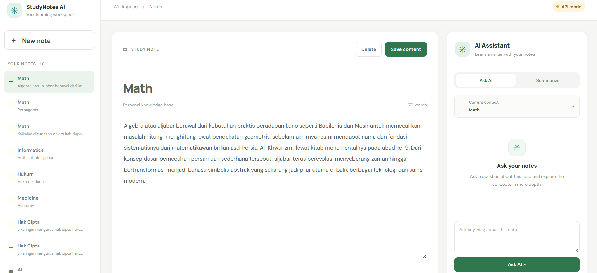

# AI Study Notes Assistant

Aplikasi pencatatan belajar berbasis web yang mengintegrasikan Large Language Model (LLM) untuk membantu pengguna memahami materi melalui ringkasan otomatis dan tanya jawab berdasarkan catatan.

## Features

- **Note Management (CRUD):** Membuat, melihat, mengedit, dan menghapus catatan belajar.
- **AI Summary:** Menghasilkan ringkasan otomatis dari isi catatan.
- **AI Q&A:** Mengajukan pertanyaan dan memperoleh jawaban yang relevan berdasarkan catatan yang dipilih.
- **Persistent Storage:** Menyimpan catatan menggunakan SQLite agar data tetap tersedia setelah halaman dimuat ulang.

## Tampilan Aplikasi



## Tech Stack

| Component | Technology |
|---|---|
| Frontend | React, Vite, JavaScript |
| Backend | Python, FastAPI |
| Database | SQLite |
| AI Integration | Groq API |
| Language Model | Qwen |

## Architecture

Aplikasi menggunakan arsitektur client-server. Frontend berkomunikasi dengan backend melalui REST API, sedangkan backend mengelola penyimpanan catatan dan integrasi dengan layanan AI.

```text
User
 |
 v
React + Vite (Frontend)
 |
 | HTTP / REST API
 v
FastAPI (Backend)
 |
 +-------------------+
 |                   |
 v                   v
SQLite Database    Groq API
                       |
                       v
                  Qwen LLM
```

### AI Workflow

**AI Summary**
1. Pengguna memilih catatan.
2. Frontend mengirimkan permintaan ringkasan ke backend.
3. Backend meneruskan instruksi dan isi catatan ke model AI melalui Groq API.
4. Model menghasilkan ringkasan.
5. Backend mengirimkan hasil untuk ditampilkan di frontend.

**AI Q&A**
1. Pengguna memilih catatan dan memasukkan pertanyaan.
2. Frontend mengirimkan pertanyaan ke backend.
3. Backend memproses pertanyaan bersama konteks catatan.
4. Model AI menghasilkan jawaban.
5. Jawaban ditampilkan kepada pengguna.

## Project Structure

```text
ai-study-notes-assistant/
├── app/
│   ├── main.py
│   ├── database/
│   │   └── database.py
│   ├── models/
│   │   └── note.py
│   └── services/
│       ├── ai_service.py
│       └── note_service.py
├── frontend/
│   ├── src/
│   │   ├── services/
│   │   │   └── api.js
│   │   ├── App.jsx
│   │   ├── App.css
│   │   └── main.jsx
│   ├── .env
│   └── package.json
├── pyproject.toml
├── README.md
└── .gitignore
```

## Getting Started

### Prerequisites

Pastikan perangkat sudah memiliki:

- Python
- uv
- Node.js dan npm
- Groq API key

### 1. Clone Repository

```bash
git clone https://github.com/Hafidh-cloude/ai-study-note-assistant.git
cd ai-study-notes-assistant
```


### 2. Configure Backend

Buat file `.env` di folder utama proyek dan masukkan API key Groq:

```env
GROQ_API_KEY=your_groq_api_key
```

Gunakan nama variabel yang sesuai dengan konfigurasi backend. Jangan mengunggah API key ke repository publik.

Instal dependensi:

```bash
uv sync
```

Jalankan backend:

```bash
uv run uvicorn app.main:app --reload
```

Backend berjalan di:

`http://127.0.0.1:8000`

Dokumentasi API FastAPI tersedia di:

`http://127.0.0.1:8000/docs`

### 3. Configure Frontend

Buka terminal baru dan masuk ke folder frontend:

```bash
cd frontend
```

Instal dependensi:

```bash
npm install
```

Buat atau periksa file `frontend/.env`:

```env
VITE_API_BASE_URL=http://127.0.0.1:8000
```

Jalankan frontend:

```bash
npm run dev
```

Buka alamat lokal yang ditampilkan oleh Vite, biasanya:

`http://localhost:5173`

Pastikan backend dan frontend sama-sama berjalan saat menggunakan aplikasi.

## API Endpoints

| Method | Endpoint | Description |
|---|---|---|
| GET | `/notes` | Mengambil daftar catatan |
| POST | `/notes` | Membuat catatan baru |
| PUT | `/notes/{note_id}` | Memperbarui konten catatan |
| DELETE | `/notes/{note_id}` | Menghapus catatan |
| POST | `/notes/{note_id}/summary` | Menghasilkan ringkasan AI |
| POST | `/notes/{note_id}/ask` | Mengajukan pertanyaan tentang catatan |

## Testing

Pengujian fungsional yang telah dilakukan secara manual mencakup:

- Memuat daftar catatan.
- Membuat, mengubah, dan menghapus catatan.
- Memastikan data tetap tersimpan setelah halaman direfresh.
- Menghasilkan ringkasan menggunakan AI.
- Mengajukan pertanyaan dan menerima jawaban AI.
- Memeriksa penanganan error ketika backend tidak tersedia.

Pengujian tersebut merupakan pengujian fungsional awal, bukan audit keamanan atau pengujian menyeluruh terhadap seluruh kondisi kegagalan.

## Security Notes

- Simpan API key dalam file `.env` di lingkungan lokal.
- Jangan mengunggah file `.env` atau kredensial ke GitHub.
- Pastikan `.env` tercantum dalam `.gitignore`.
- Gunakan konfigurasi environment yang sesuai ketika aplikasi dijalankan di lingkungan lain.

## Future Improvements

Beberapa pengembangan yang dapat dipertimbangkan:

- Menambahkan autentikasi pengguna.
- Meningkatkan validasi input dan penanganan error.
- Menambahkan pengujian otomatis untuk backend dan frontend.
- Menyediakan demo aplikasi dan dokumentasi visual.

## Author

Dikembangkan oleh Hafidh Aulia Rahman sebagai proyek portofolio untuk mempraktikkan pengembangan aplikasi web, integrasi REST API, pengelolaan database, dan integrasi Large Language Model (LLM).